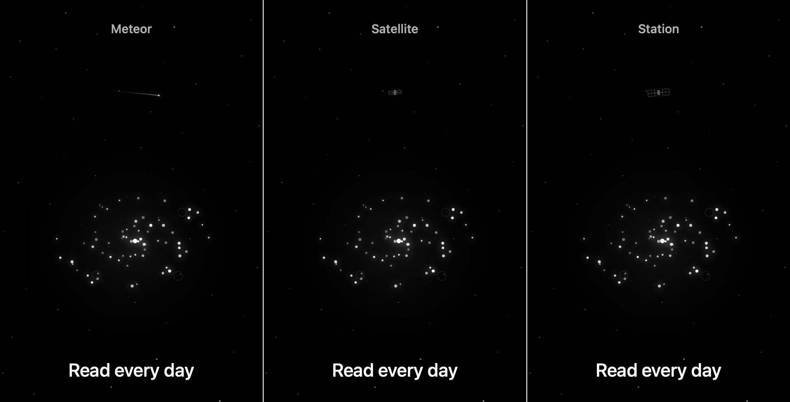

# Ambient event refinement

The first version used cyan panels and the same six-second traversal for every event. Each SpaceBackground also owned its own timer, so navigation could restart a recognizable rhythm.

## Appearance

- White points, fine wireframe lines and soft white glow match the existing galaxy and background stars.
- Meteors have a small head and a thin fading tail. Satellites/stations use distant, low-contrast silhouettes rather than solid colored panels.
- Decorative objects stay below the prominence of the challenge galaxy and pass touches through.

## Motion and timing

- Meteors last 0.9–1.8 seconds, satellites 10–17 seconds, and stations 18–26 seconds.
- Each event gets a stable randomized size, brightness, height, direction and path. Spacecraft use shallow curved passes; meteor tails align with their travel direction.
- The scheduler mixes 10–28, 35–65 and occasional 80–120 second quiet periods. The next type differs from the last; weighted selection favors meteors over stations.
- One environment-injected AmbientSpaceScene belongs to the app window, so navigating between pages does not restart the schedule. No global Singleton is introduced.
- Reduce Motion and inactive scene state suppress ambient movement. Returning from background schedules a fresh quiet period rather than replaying an interrupted object.

## Verification

App and embedded widget Simulator Debug build passed. Seeded regression samples cover all three kinds, both directions, timing diversity, safe parameter ranges and no immediate type repeats; existing storage/edit checks still pass.

The image below renders the actual revised event and galaxy Views at selected midpoints against a representative star field. It is a design preview, not a screenshot of the app screen or evidence of real-time animation testing. Labels identify event types only and are not added to the product.

On-device assessment of perceived timing, brightness and movement remains useful, particularly at low screen brightness.
